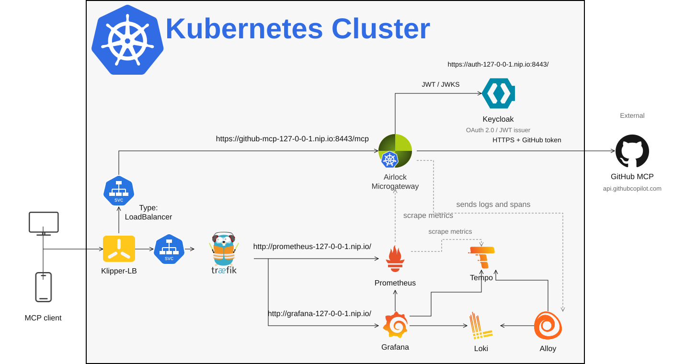
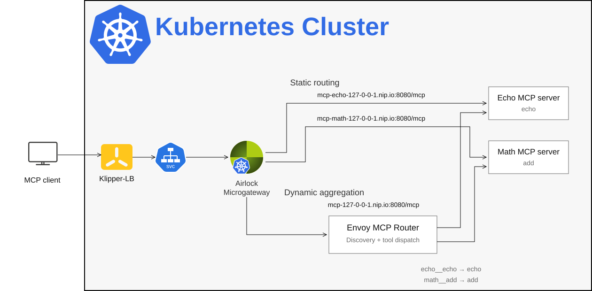

# 🔌 Airlock Microgateway MCP Example

This fourth scenario integrates the working **Microgateway as MCP Gateway** demo alongside [Web Protection](README-webprotect.md), [OIDC](README-oidc.md), and [Tracing](README-trace.md).

The main example protects the **GitHub MCP server** with **Keycloak JWT authentication**, demonstrates tool access policies, and records MCP activity in the existing monitoring stack. It is adapted from the supplied `microgateway-as-mcp-gateway-main` project. It reuses this repository's shared gateway instead of installing another Microgateway operator, gateway, certificate authority, or monitoring stack.

## 🖼 Architecture Overview



- **Static routing:** an HTTPRoute sends `/mcp` on the GitHub hostname to `api.githubcopilot.com` over verified TLS. Microgateway validates the client JWT and substitutes the configured GitHub token upstream.
- **MCP inspection:** the supplied Envoy MCP filter extracts the JSON-RPC method and target for logging. The supplied access policies use the `mcp-name` request header and the JWT email claim.
- **Authentication:** Keycloak publishes the `mcp` realm through a ListenerSet on the shared gateway's HTTPS port 8443. The gateway fetches JWKS over the in-cluster Keycloak service.
- **Observability:** the existing Alloy/Loki, Prometheus, Grafana and gateway tracing configuration are reused. The original MCP access-control dashboards and a compact routing dashboard are included.
- **Optional dynamic routing:** a separate local lab aggregates two servers behind one endpoint and routes tool calls by their discovered tool names. Its companion router is described below.

> [!WARNING]
> This preserves the supplied proof-of-concept access policy: `mcp-name` is client-controlled and is not checked against the JSON-RPC body. Missing headers permit authenticated protocol traffic; they can also bypass tool restrictions. This is a policy demonstration, not a secure read-only boundary. Use a read-only GitHub token scoped to a disposable demonstration repository. The local routing lab has no authentication and is for trusted local access only.

## 🌐 Application Access

| Application | URL |
|---|---|
| GitHub MCP | https://github-mcp-127-0-0-1.nip.io:8443/mcp |
| OAuth resource metadata | https://github-mcp-127-0-0-1.nip.io:8443/.well-known/oauth-protected-resource/mcp |
| Keycloak issuer | https://auth-127-0-0-1.nip.io:8443/realms/mcp |
| Grafana | http://grafana-127-0-0-1.nip.io |

These hostnames resolve to loopback. Run clients on the workstation exposing the cluster ports. For remote access, change hostnames, certificate DNS names, issuer and metadata URLs together.

## ⚙️ Prerequisites

Complete the [Kubernetes setup](../README-k8s.md) or [OpenShift setup](../README-openshift.md) before deploying this scenario.

Additional requirements for this scenario:

- A valid GitHub Personal Access Token (PAT) for the GitHub MCP example.
- Python and curl for the verification commands.
- Node.js and npm if using MCP Inspector.

Run all commands below from the **repository root**.

## 🛠 Deploy the GitHub MCP Example

### 1. Apply MCP resources

```bash
kubectl apply --server-side -k manifests/mcp

kubectl -n mcp rollout status deployment/keycloak --timeout=180s
kubectl -n mcp wait --for=condition=Ready certificate/mcp-gateway-tls --timeout=120s
kubectl -n mcp get listenerset,httproute
```

This deploys Keycloak and imports the demo realm. GitHub MCP remains external. Keycloak uses an ephemeral development database; restarting its pod recreates the imported demo realm.

The imported realm replaces the source demo's manual Keycloak provisioning with reproducible demo users and a fixed public PKCE client, `mcp-demo`. Inspector must use that client ID explicitly; anonymous dynamic client registration is not enabled. The original source's neutral login theme is omitted.

### 2. Configure the GitHub token

The HTTPRoute contains a placeholder. Enter the real token without saving it into a repository file:

```bash
read -rsp 'GitHub token: ' GITHUB_PAT; echo
export GITHUB_PAT
bash scenarios/scripts/set-mcp-github-token.sh
unset GITHUB_PAT
```

The token is stored in the live HTTPRoute. Restrict Kubernetes access to that resource. Reapplying the GitHub manifests resets the header to the placeholder, so run the token helper again afterward.

### 3. Trust the lab certificate and connect

Export the demo CA certificate:

```bash
kubectl -n mcp get secret mcp-gateway-tls -o jsonpath='{.data.ca\.crt}' | base64 -d > /tmp/mcp-ca.crt
curl --cacert /tmp/mcp-ca.crt \
  https://github-mcp-127-0-0-1.nip.io:8443/.well-known/oauth-protected-resource/mcp

bash scenarios/scripts/start-mcp-inspector.sh /tmp/mcp-ca.crt
```

In Inspector add a **Streamable HTTP** server using the GitHub MCP URL above. Set its OAuth client ID to **`mcp-demo`**, leave the client secret empty, and use PKCE. The registered callback URLs are `http://localhost:6274/oauth/callback` and `http://127.0.0.1:6274/oauth/callback`. If your client uses another callback, register that exact URI in `manifests/mcp/github/realm.json` before deployment. Trust the demo CA in your browser for the Keycloak login.

| User | Password | Email | Expected policy with matching `mcp-name` headers |
|---|---|---|---|
| user1 | password | user1@example.org | Connect/list permitted; listed read tools denied |
| user2 | password | user2@airlock.com | Connect/list and the configured read tools permitted |

Connect as each user, discover tools and compare the policy decisions. Clients that omit `mcp-name` do not exercise the intended tool restrictions; see the warning above. The source's allowlist is a fixed demonstration list and may need updates as GitHub tools change.

### 4. Check authentication without a browser

The lab client permits password grants for this check. This verifies JWT handling, not the browser PKCE flow:

```bash
TOKEN=$(curl --fail --silent --show-error --cacert /tmp/mcp-ca.crt \
  -d client_id=mcp-demo -d grant_type=password \
  -d username=user2 -d password=password -d 'scope=openid profile email' \
  https://auth-127-0-0-1.nip.io:8443/realms/mcp/protocol/openid-connect/token \
  | python3 -c 'import json,sys; print(json.load(sys.stdin)["access_token"])')

curl --cacert /tmp/mcp-ca.crt -i \
  -H "Authorization: Bearer $TOKEN" \
  -H 'Content-Type: application/json' -H 'Accept: application/json, text/event-stream' \
  --data-binary @scenarios/scripts/mcp-initialize.json \
  https://github-mcp-127-0-0-1.nip.io:8443/mcp
unset TOKEN
```

An unauthenticated request to `/mcp` should return **401** with the resource metadata challenge. A valid JWT plus a valid GitHub PAT should allow initialization. Follow the returned MCP session headers for further requests.

## 📊 Inspect MCP Activity

In Grafana, open the **Airlock Microgateway** folder:

- **Airlock Microgateway Access Control MCP Metrics** and **Access Control MCP Logs** are the dashboards supplied with the original MCP project. Select the existing Loki data source if prompted.
- **Airlock Microgateway MCP Routing** shows requests by MCP method, calls by tool name and access logs using this repository's `loki` data source.

Example Loki query:

```logql
{container="airlock-microgateway-engine"} |= "envoy.access" | json | mcp_method != ""
```

Inspect `mcp.method`, `mcp.tool_name`, `airlock.route`, and `airlock.access_control` for authenticated/authorized decisions. Existing Prometheus dashboards continue to show gateway traffic. The gateway's existing tracing exporter stays enabled; the minimal local servers below do not emit backend spans.

## 🔀 Optional Local Static and Dynamic Routing Lab

This extension is separate from the supplied GitHub demo. It requires no GitHub token, Keycloak, or external MCP server. It deploys two tiny Python servers and one Envoy MCP aggregator.



Static routes connect Microgateway directly to one server. The dynamic endpoint presents one discovered tool catalog, prefixes tools with a backend name, and dispatches each call to the corresponding server. This is a configured backend catalog, not unrestricted proxying to client-selected destinations.

> The native Envoy MCP Router is a terminal filter that replaces the final HTTP router. Microgateway's EnvoyExtensionPolicy exposes prepend/append insertion, not terminal-router replacement. This optional lab therefore runs the aggregator as a small companion behind Microgateway; it does not claim that aggregation happens inside the shared Microgateway. The main GitHub example uses the supplied Microgateway MCP inspection filter directly.

```bash
kubectl apply --server-side -k manifests/mcp/local
kubectl -n mcp rollout status deployment/mcp-echo --timeout=120s
kubectl -n mcp rollout status deployment/mcp-math --timeout=120s
kubectl -n mcp rollout status deployment/mcp-router --timeout=120s
python3 scenarios/scripts/check-mcp.py
```

| Mode | URL | Tools |
|---|---|---|
| Static echo | http://mcp-echo-127-0-0-1.nip.io:8080/mcp | `echo` |
| Static math | http://mcp-math-127-0-0-1.nip.io:8080/mcp | `add` |
| Dynamic aggregation | http://mcp-127-0-0-1.nip.io:8080/mcp | `echo__echo`, `math__add` |

These are **MCP protocol endpoints**, not browser pages. Opening the static echo or math URL in a browser sends GET and returns **405 Method Not Allowed**, as expected: these stateless servers do not provide a standalone SSE stream. Connect with an MCP client using **Streamable HTTP**, or run the check script above.

To call the echo tool directly from a terminal:

```bash
curl --noproxy '*' http://mcp-echo-127-0-0-1.nip.io:8080/mcp \
  -H 'Content-Type: application/json' \
  -H 'Accept: application/json, text/event-stream' \
  -d '{"jsonrpc":"2.0","id":1,"method":"tools/call","params":{"name":"echo","arguments":{"text":"Hello MCP"}}}'
```

Expected result: a JSON-RPC response containing `Hello MCP`.

The check displays the server identity, negotiated protocol, discovered tools, actual tool arguments, returned JSON, expected result, HTTP status and request timing. Each run uses a fresh echo marker and new arithmetic inputs, so the output demonstrates a live round trip. It also displays the actual unknown-tool rejection and retains any session headers returned by the aggregator.

Successful output ends with `RESULT: 3/3 endpoints verified | 4 tool results matched`. The same inputs are checked against the static endpoints and the aggregated endpoint, demonstrating that both routing paths return the expected results. Failures show their details and produce a nonzero exit status.

The local servers implement the tools capability of stateless Streamable HTTP, returning JSON responses without standalone SSE streams, persistent sessions or server-initiated requests. The Envoy MCP extensions are experimental; this is a trusted local demonstration.

## 📚 References

- [Airlock Microgateway documentation](https://docs.airlock.com/microgateway/latest/)
- [Envoy MCP filter](https://www.envoyproxy.io/docs/envoy/latest/configuration/http/http_filters/mcp_filter)
- [Envoy MCP Router](https://www.envoyproxy.io/docs/envoy/latest/configuration/http/http_filters/mcp_router_filter)
- [Model Context Protocol](https://modelcontextprotocol.io/specification/latest)
- [GitHub MCP server](https://github.com/github/github-mcp-server)

Source example code is covered by the repository [MIT license](../LICENSE). Airlock Microgateway licensing applies to its authentication and security features.
