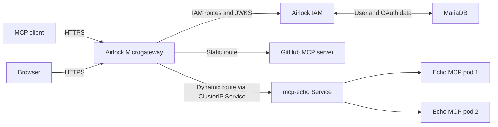
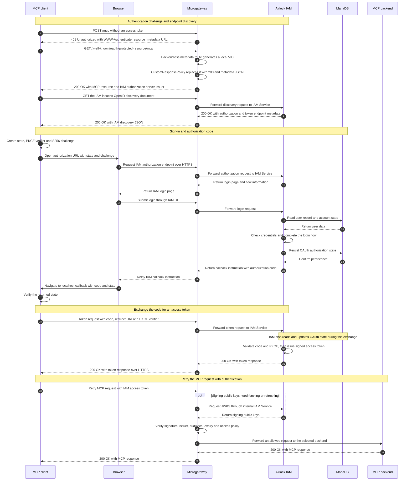

# 🔌 Airlock Microgateway MCP with Airlock IAM

<p align="left">
  
</p>

Extend the running example with **Airlock IAM** as the authorization server for MCP clients. This guide deploys **IAM with MariaDB**, protects the external **GitHub MCP server**, and adds optional **dynamic routing** to replicated pods of a local MCP server.

Follow the stages below to prepare IAM, connect it to the shared gateway, and try both MCP routing examples. This optional scenario needs its own IAM license and application Secrets and is deployed after the general setup.

---

## 🖼 Architecture Overview

**Component map** — this shows connections, not the order of requests:



**Numbered request flow** — follow this sequence from top to bottom. It starts with an MCP request without an access token and shows discovery for a client without cached metadata. The client ID is preconfigured in Inspector as described below.



Solid arrows are requests/actions; dashed arrows are responses. IAM's login UI makes several page/API requests, grouped here into a login exchange. Database arrows summarize the configured persistence, rather than individual SQL transactions. The callback instruction may be returned through the UI's flow response; the browser then navigates to the client's registered localhost callback.

The initial **401** challenges the client to authenticate; it does not redirect the browser. The **500 → 200** replacement happens only inside Microgateway on the separate metadata route. The client receives **200 with JSON**, reads the IAM issuer, retrieves IAM's discovery document through Microgateway, and then starts browser authorization. IAM is not involved in serving the MCP resource metadata. Subsequent MCP discovery and tool calls also carry the access token and pass through the gateway's validation.

MariaDB returns data **to IAM** and confirms persisted state. IAM performs authentication and resumes the OAuth flow. The browser callback happens only after IAM returns the authorization-code instruction through Microgateway. Passwords are entered into IAM's browser UI; the MCP client exchanges the returned code using its PKCE verifier.

In this sequence, **MCP backend** means GitHub for the static endpoint or an echo pod selected through the `mcp-echo` ClusterIP Service for the dynamic endpoint. For static routing, Microgateway substitutes the GitHub PAT upstream. For dynamic routing, Microgateway uses the Service's available backend endpoints; each replica exposes the same `echo` tool. Failed authentication or authorization stops the request at the gateway; it is not forwarded to a backend.

**How the components work together:**

- **IAM** authenticates the user and issues a signed access token to the MCP client. MariaDB stores IAM users and OAuth data; the signing keystore persists on IAM's own volume.
- **Microgateway** validates the token's signature, issuer, audience and expiry before allowing MCP traffic.
- **Static routing** forwards requests to the fixed GitHub MCP backend. A separate GitHub PAT authenticates the gateway's upstream requests; the IAM token is not sent to GitHub.
- **Dynamic routing** forwards authenticated requests directly to echo MCP pods using a Kubernetes ClusterIP Service and its label selector. Kubernetes tracks ready pods as replicas scale or are replaced; Microgateway updates its backend endpoints without changing the HTTPRoute.
- **Adminapp** is reachable through Microgateway without gateway authentication or content-security protection. IAM's own administrator login remains enabled.

**IAM login and token requests also pass through Microgateway.** The browser and MCP client use `https://iam-mcp-127-0-0-1.nip.io:8443`; they do not use IAM's internal Service address. “Browser login and PKCE” describes the OAuth flow, not an additional Service or a direct client-to-IAM network connection.

| Network step | Kubernetes resource | Connection |
|---|---|---|
| Workstation → gateway | `airlock-gateway/airlock-gateway` Service, type `LoadBalancer` | HTTPS on port 8443 |
| Gateway → IAM | `mcp/airlock-iam` Service, type `ClusterIP` | HTTP on port 8080, selected by the `airlock-iam` HTTPRoute for `/auth-login` |
| Gateway → signing public keys | Same IAM ClusterIP Service | Internal JWKS request on port 8080 |

TLS terminates at Microgateway. The gateway preserves the public URL in forwarding headers, so IAM advertises the external HTTPS endpoints. IAM's Service also declares an internal HTTPS port, but this HTTPRoute uses port 8080. The browser's localhost OAuth callback returns to the MCP client; it is separate from the routed IAM endpoints.

The application resources use `mcp`; the gateway uses `airlock-gateway`. The scenario reuses the gateway, CA, monitoring and tracing from the general setup; it installs no second operator or shared platform.

## 🌐 Application Access

| Application | URL |
|---|---|
| IAM Adminapp | https://iam-mcp-127-0-0-1.nip.io:8443/auth-admin/ |
| IAM Loginapp | https://iam-mcp-127-0-0-1.nip.io:8443/auth-login/ |
| IAM Logout | https://iam-mcp-127-0-0-1.nip.io:8443/auth-login/ui/app/auth/logout |
| Static GitHub MCP | https://github-mcp-iam-127-0-0-1.nip.io:8443/mcp |
| Static resource metadata | https://github-mcp-iam-127-0-0-1.nip.io:8443/.well-known/oauth-protected-resource/mcp |
| Dynamic echo MCP | https://mcp-iam-127-0-0-1.nip.io:8443/mcp |
| Dynamic resource metadata | https://mcp-iam-127-0-0-1.nip.io:8443/.well-known/oauth-protected-resource/mcp |

These names resolve to loopback. Run clients on the workstation exposing Rancher Desktop's gateway ports. For remote access, update hostnames, certificate names, issuer/audience URLs and resource metadata together.

---

## 🧰 General Prerequisites

This scenario targets Kubernetes/Rancher Desktop. Complete the [Kubernetes setup](../README-k8s.md) first. Reuse its Microgateway operator, Gateway, cert-manager, CA, session store and monitoring stack. The MCP example adds application resources rather than another platform installation.

The shared [GatewayParameters](../manifests/airlock-microgateway/base/gatewayparameters.yaml) enables external-name services for GitHub and the Envoy MCP inspection extension. The normal secured defaults, Valkey sessions and tracing for the other scenarios remain in place. MCP and IAM routes explicitly select their lab content-security policy.

Additional requirements:

- An IAM license and registry pull credentials as described here [Airlock IAM Kubernetes Example.](https://github.com/airlock-presales/iam-kubernetes-example)
- A Microgateway license covering the authentication and MCP features used here.
- Python and `curl`; no extra Python packages are required by the user-facing helpers.
- Node.js/npm for MCP Inspector.
- A GitHub PAT for static GitHub calls. The local dynamic example does not use it.

Run all commands from the **repository root**, selecting the intended context:

```bash
export LAB_CONTEXT=rancher-desktop
kubectl --context "$LAB_CONTEXT" get nodes
kubectl --context "$LAB_CONTEXT" -n airlock-gateway get gateway,service
mkdir -p .local/mcp
chmod 700 .local/mcp
```

## 🛡️ Prepare the IAM Namespace, License and Pull Credentials

The IAM and MariaDB deployment is based on the [Airlock IAM Kubernetes Example](https://github.com/airlock-presales/iam-kubernetes-example). That repository explains the underlying IAM deployment and database integration. The following steps use the configuration supplied with this MCP scenario; a separate deployment of the IAM example is not required.

```bash {"cwd":"../"}
kubectl --context "$LAB_CONTEXT" apply -f manifests/mcp/namespace.yaml
```

Place the IAM license at `.local/mcp/iam-license.txt` and the registry Docker configuration at `.local/mcp/iam-dockerconfig.json`. For a new installation:

```bash {"cwd":"../"}
kubectl --context "$LAB_CONTEXT" -n mcp create secret generic airlock-iam-license \
  --from-file=license.txt=.local/mcp/iam-license.txt

kubectl --context "$LAB_CONTEXT" -n mcp create secret generic iam-pull-secret \
  --type=kubernetes.io/dockerconfigjson \
  --from-file=.dockerconfigjson=.local/mcp/iam-dockerconfig.json
```

The license is mounted into IAM as `/home/airlock/iam/license.txt`. The pull Secret must exist in `mcp`, where the IAM pod runs. Reuse existing Secrets rather than overwriting them or exposing their contents.

## 🗄️ Prepare MariaDB and IAM Secrets

Generate fresh database credentials and IAM crypto values once for a new set of persistent volumes:

```bash {"cwd":"../"}
python3 scenarios/scripts/create-mcp-secrets.py
kubectl --context "$LAB_CONTEXT" -n mcp apply -f .local/mcp/secrets.yaml
```

The helper only writes the private local Secret file; it does not install the scenario and refuses to overwrite an existing file. Keep that file with the matching volumes. Do not generate replacement passwords for an existing database or signing keystore.

Before deploying, inspect the wiring:

| File or setting | Connection to inspect |
|---|---|
| [IAM StatefulSet](../manifests/mcp/apps/iam/statefulset.yaml) | `IAM_DB_DRIVER_CLASS`, `IAM_DB_URL`, `IAM_DB_USER`, `IAM_DB_PASSWORD` |
| `mariadb-credentials` Secret references | The same account credentials are supplied to MariaDB and IAM |
| [IAM packaging](../manifests/mcp/apps/iam/kustomization.yaml) | The JDBC driver is mounted into IAM's common libraries |
| [Database packaging](../manifests/mcp/apps/database/kustomization.yaml) | Schema and demo accounts initialize an empty database volume |
| [IAM bootstrap configuration](../manifests/mcp/configuration/iam/iam-mcp.yaml) | The JDBC pool binds its properties to the environment variables |

The JDBC URL points to `mariadb.mcp.svc.cluster.local`. MariaDB owns the account and data; changing a Secret alone does not change an existing database password. The schema initialization files run only when the database volume is empty.

## 🚀 Deploy MariaDB and IAM

```bash {"cwd":"../"}
kubectl --context "$LAB_CONTEXT" apply --server-side -k manifests/mcp/apps

kubectl --context "$LAB_CONTEXT" -n mcp rollout status statefulset/mariadb --timeout=180s
kubectl --context "$LAB_CONTEXT" -n mcp rollout status statefulset/airlock-iam --timeout=180s
kubectl --context "$LAB_CONTEXT" -n mcp get pods,pvc
```

On first startup, MariaDB creates its schema and demo accounts. IAM initializes its instance and persistent signing keystore, then copies the prepared configuration from `iam-mcp-config`. On later starts it retains the active configuration and key on its own volume. Updating the bootstrap ConfigMap does not overwrite an existing instance.

## 🌐 Publish IAM and Static GitHub MCP

```bash {"cwd":"../"}
kubectl --context "$LAB_CONTEXT" apply -k manifests/mcp/gateway
kubectl --context "$LAB_CONTEXT" -n mcp wait \
  --for=condition=Ready certificate/mcp-gateway-tls --timeout=120s
kubectl --context "$LAB_CONTEXT" -n mcp get listenerset,httproute
```

Follow the resources in [gateway configuration](../manifests/mcp/gateway):

1. The annotated **ListenerSet** adds HTTPS on the existing shared gateway. cert-manager generates `mcp-gateway-tls` from its four listener hostnames, preserving the shared TLS Secret.
2. **IAM HTTPRoutes** send `/auth-login` and `/auth-admin` to IAM's internal Service.
3. The **GitHub HTTPRoute** selects the fixed external GitHub MCP service over verified TLS.
4. **JWKS and JWT** define IAM's public signing keys and the issuer/audience accepted by Microgateway.
5. The **AccessControlPolicy** attaches JWT authentication and the demonstration tool/email checks to the MCP route.
6. **Protected-resource metadata** tells the client which IAM authorization server to use.

Adminapp has no gateway authentication policy or secured content profile. Its own IAM administrator login stays enabled. Public IAM URLs remain HTTPS, while the gateway's internal IAM/JWKS connection uses the Service on port 8080.

> [!NOTE]
> Reapplying the GitHub route restores its PAT placeholder. Apply the real upstream token after deploying these resources, and avoid reapplying that route during unrelated IAM changes.

## 🔏 Trust the Lab Certificate

Export only the public CA certificate:

```bash {"cwd":"../"}
kubectl --context "$LAB_CONTEXT" -n mcp get secret mcp-gateway-tls \
  -o jsonpath='{.data.ca\.crt}' | base64 -d > .local/mcp/iam-mcp-ca.crt

curl --cacert .local/mcp/iam-mcp-ca.crt \
  https://github-mcp-iam-127-0-0-1.nip.io:8443/.well-known/oauth-protected-resource/mcp
```

The JSON should identify the static GitHub MCP resource and IAM issuer. Trust this CA in the browser used for login and in the MCP client; no private key is needed and TLS verification should remain enabled.

## 🔐 Inspect IAM in the Config Editor

Open **[IAM Adminapp](https://iam-mcp-127-0-0-1.nip.io:8443/auth-admin/)** and sign in with the seeded lab administrator:

| Account | Password | Purpose |
|---|---|---|
| `admin` | `Start123!` | IAM administration and configuration |
| `user1` | `Start123!` | Email `user1@example.org`, outside the demonstration tool-policy domain |
| `user2` | `Start123!` | Email `user2@airlock.com`, permitted with matching tool headers |

These are disposable demonstration accounts; do not expose the lab publicly with them.

In the **Config Editor**, inspect Loginapp's OAuth/OIDC authorization servers:

| Setting | Static GitHub | Dynamic echo |
|---|---|---|
| Authorization server ID | `mcp` | `mcp-dynamic` |
| Public client ID | `mcp-demo` | `mcp-dynamic-demo` |
| Client secret | None | None |
| Flow | Authorization code with mandatory PKCE S256 | Same |
| Exact callbacks | `http://localhost:6274/oauth/callback`, `http://127.0.0.1:6274/oauth/callback` | Same |
| Access-token audience | Static GitHub MCP URL | Dynamic MCP URL |

The dynamic client is prepared in IAM; its server pods and public route are deployed in the optional step below. Inspect the signed JWT access-token format, subject/email claims and audience. Microgateway uses access tokens, not ID tokens, as MCP credentials.

Both browser authorization and the client's code exchange traverse Microgateway. The browser's localhost callback returns the authorization code to the MCP client, which exchanges it with its PKCE verifier through the gateway.

## 🔑 Configure the GitHub PAT from a File

The main-directory `github_pat.txt` contains a dummy. The helper reads that file by default:

```bash {"cwd":"../"}
python3 scenarios/scripts/set-mcp-github-token.py --context "$LAB_CONTEXT" --set-pat
```

For real GitHub calls, the selected file must contain a valid PAT on one line. Keep the committed main file as a dummy; never commit a real token. Another file is selected only with an explicit `--token-file <path>` argument. Private files under `.local` are not selected automatically.

The helper patches only the upstream Authorization replacement on `mcp/github-mcp`, using a private temporary patch file and a resource-version check. It does not change IAM credentials or the dynamic backend. No token value needs to appear in CLI arguments or exported variables.

> [!WARNING]
> Applying the dummy replaces the live PAT with the dummy, so GitHub calls fail. The applied credential is stored in the HTTPRoute and is readable by users who can read that resource. Use a narrowly scoped read-only PAT for this lab.

## 🔌 Connect to Static GitHub MCP

Start Inspector after exporting the CA:

```bash {"cwd":"../"}
bash scenarios/scripts/start-mcp-inspector.sh
```

The launcher supplies the CA to the Inspector process; browser trust must still be configured separately.

In Inspector:

1. Select **Streamable HTTP** and enter the static GitHub MCP URL from the access table.
2. In **Server Settings → OAuth Settings**, set client ID **`mcp-demo`**, leave **Client Secret** and **Scopes** empty, and uncheck **Request refresh token**. Inspector handles PKCE S256 automatically.
3. Connect, sign in through IAM as `user2`, initialize and discover tools.
4. Call the read-only `get_me` tool to exercise IAM → Microgateway → GitHub.

This IAM configuration accepts empty scopes and always grants `profile` and `email`. It does not issue refresh tokens.

To switch users, open [IAM Logout](https://iam-mcp-127-0-0-1.nip.io:8443/auth-login/ui/app/auth/logout) in the same browser, then clear the affected server's stored OAuth state and disconnect in Inspector. Reconnect to sign in as the other user. IAM logout ends the browser session; Inspector's access token must also be cleared. Opening the Loginapp root starts login again rather than logging out.

For a repeatable API/protocol check:

```bash {"cwd":"../"}
python3 scenarios/scripts/check-mcp.py
```

It prompts for an IAM test password and verifies PKCE login, MCP initialization, tool discovery and `get_me`. Tokens/cookies stay in memory. Connection settings are also recorded in [the static client profile](mcp/inspector-connection.json).

## 🔀 Add Dynamic MCP Routing

This example routes directly to a replicated echo MCP server through a Kubernetes **ClusterIP Service**. Its label selector identifies the server pods, and Kubernetes updates the ready endpoints as pods are added or replaced. Every replica exposes the same `echo` tool.

Inspect the resources before deploying:

| Resource | Purpose |
|---|---|
| [Echo Deployment and Service](../manifests/mcp/dynamic/servers.yaml) | Two stateless replicas; the Service selects pods labeled `app: mcp-echo` |
| [Dynamic HTTPRoute](../manifests/mcp/dynamic/route.yaml) | Sends `/mcp` directly to the `mcp-echo` Service on port 8000 |
| [Access policy](../manifests/mcp/dynamic/accesscontrolpolicy.yaml) | Requires an IAM access token for the dynamic resource |
| [MCP inspection policy](../manifests/mcp/dynamic/policies.yaml) | Enables MCP parsing inside Microgateway |

```bash {"cwd":"../"}
kubectl --context "$LAB_CONTEXT" apply --server-side -k manifests/mcp/dynamic
kubectl --context "$LAB_CONTEXT" -n mcp rollout status deployment/mcp-echo --timeout=180s
kubectl --context "$LAB_CONTEXT" -n mcp get pods -l app=mcp-echo
kubectl --context "$LAB_CONTEXT" -n mcp get service mcp-echo
kubectl --context "$LAB_CONTEXT" -n mcp get endpointslices \
  -l kubernetes.io/service-name=mcp-echo
```

Use the dynamic MCP URL. In this server's **Server Settings → OAuth Settings**, set client ID **`mcp-dynamic-demo`**, leave **Client Secret** and **Scopes** empty, and uncheck **Request refresh token**. Inspector handles PKCE S256 automatically. Its authorization server is `mcp-dynamic`, with an issuer/audience distinct from static GitHub. Microgateway authenticates requests before forwarding them directly to an echo pod. The local server has no separate public route.

Discover the `echo` tool and call it with `{"text":"Hello through Microgateway"}`. The result is the same text. The response header `X-MCP-Backend-Pod` identifies the serving replica; the server takes this value from its Kubernetes pod name.

```bash {"cwd":"../"}
python3 scenarios/scripts/check-mcp.py --dynamic
```

The check verifies IAM PKCE, resource discovery, unauthenticated rejection, the `echo` catalog, fresh echo calls, unknown-tool rejection and token isolation from the static endpoint. It prints the backend pod names observed across its requests. See [the dynamic client profile](mcp/inspector-dynamic-connection.json).

### Observe Backend Changes

Scale the server and inspect its endpoints. The HTTPRoute and public URL stay the same:

```bash {"cwd":"../"}
kubectl --context "$LAB_CONTEXT" -n mcp scale deployment/mcp-echo --replicas=3
kubectl --context "$LAB_CONTEXT" -n mcp rollout status deployment/mcp-echo --timeout=180s
kubectl --context "$LAB_CONTEXT" -n mcp get pods -l app=mcp-echo
kubectl --context "$LAB_CONTEXT" -n mcp get endpointslices \
  -l kubernetes.io/service-name=mcp-echo
python3 scenarios/scripts/check-mcp.py --dynamic --samples 24
```

Replace the server pods with a rolling restart, then run the check again. The reported backend names should now belong to the replacement pods:

```bash {"cwd":"../"}
kubectl --context "$LAB_CONTEXT" -n mcp rollout restart deployment/mcp-echo
kubectl --context "$LAB_CONTEXT" -n mcp rollout status deployment/mcp-echo --timeout=180s
kubectl --context "$LAB_CONTEXT" -n mcp get pods -l app=mcp-echo
python3 scenarios/scripts/check-mcp.py --dynamic --samples 24
kubectl --context "$LAB_CONTEXT" -n mcp scale deployment/mcp-echo --replicas=2
kubectl --context "$LAB_CONTEXT" -n mcp rollout status deployment/mcp-echo --timeout=180s
```

This server is stateless, so each request can use any ready replica. Stateful MCP servers need an appropriate session-routing design when replicated.

## 📊 Inspect MCP Activity

The scenario reuses the general setup's Alloy/Loki, Prometheus and Grafana integrations. Install only the MCP dashboards:

```bash {"cwd":"../"}
kubectl --context "$LAB_CONTEXT" apply -k manifests/mcp/observability
```

Open Grafana's **Airlock Microgateway** folder and inspect **Access Control MCP Logs**, **Access Control MCP Metrics** and **MCP Routing**. Select the existing Loki/Prometheus data sources if prompted. The shared Telemetry resource adds parsed MCP method/tool fields while retaining the existing tracing configuration.

Example Loki query:

```logql
{container="airlock-microgateway-engine"} |= "envoy.access" | json | mcp_method != ""
```

Use the dashboards to follow MCP methods and tool calls and to see the corresponding IAM authentication and gateway authorization decisions.

## 📝 Configuration Ownership and Updates

**Kubernetes and IAM Config Editor do not synchronize changes automatically.** Ownership is per setting:

| Setting | Change it in | Apply the change |
|---|---|---|
| Database endpoint/user and externally supplied passwords/keys | Kubernetes manifests/Secrets | Coordinate the database/keystore change when necessary, then replace the IAM pod |
| Non-bound OAuth clients, callbacks and flows | Config Editor or reviewed repository configuration | Activate; export/reconcile editor changes before the next deployment |
| Gateway routes, certificates and backends | Kubernetes manifests | Apply the relevant resources and restore the PAT if its route was reapplied |

IAM already lists environment bindings in the **Variables** tab. The binding identifies an external startup value; editing its fallback does not update a Kubernetes Secret. Sensitive fallbacks use `[FILE]` references to the same Secret, allowing native validation without storing passwords in YAML. Read-only `subPath` files and process environment values refresh together on pod replacement.

Changing a Secret does not rotate an existing MariaDB account or the persistent signing keystore. Keep the private local credential backup synchronized after a reviewed rotation. Editor saves persist on IAM's volume; the bootstrap ConfigMap only initializes new instances.

For a reviewed repository update to the active instance:

```bash {"cwd":"../"}
python3 scenarios/scripts/activate-mcp-iam-config.py --context "$LAB_CONTEXT" --activate
```

The helper validates the configuration, keeps a backup and activates the reviewed update. Export and reconcile Config Editor changes before applying a repository update.

> [!WARNING]
> This is a lab with seeded accounts and unsecured content profiles on its application routes. The inherited GitHub tool-policy demonstration trusts client-controlled `mcp-name`; omitted or mismatched headers can bypass tool restrictions. JWT authentication still applies. Offline JWT checks also mean logout/revocation does not immediately invalidate a token already issued.

## 📚 References

- [Microgateway documentation](https://docs.airlock.com/microgateway/latest/)
- [IAM documentation](https://docs.airlock.com/iam/latest/)
- [Airlock IAM Kubernetes Example](https://github.com/airlock-presales/iam-kubernetes-example)
- [Source license](../LICENSE). The JDBC driver retains its [upstream licensing](https://github.com/mariadb-corporation/mariadb-connector-j).
